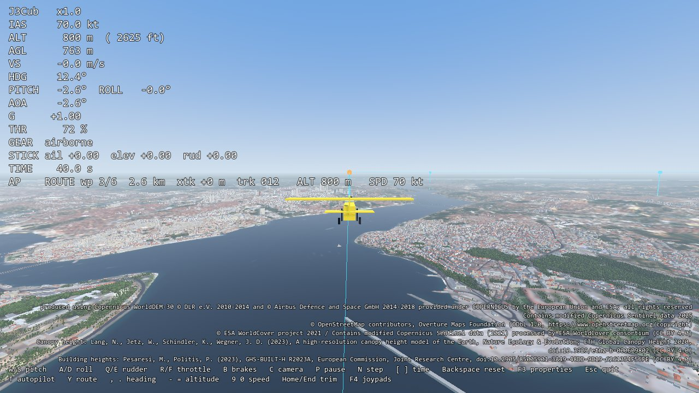
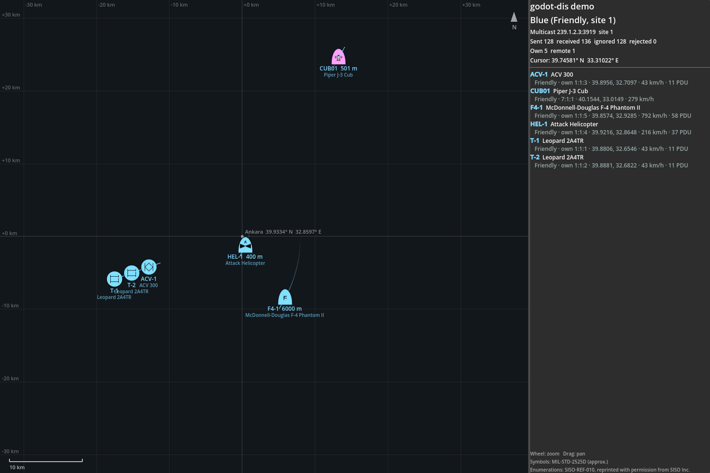

# godot-jsbsim

[JSBSim](https://github.com/JSBSim-Team/jsbsim) flight dynamics for Godot 4: load JSBSim aircraft models, fly them
in step with Godot's physics, and place them on the WGS84 globe in the same local frame as godot-dis and godot-geo.
A C++ GDExtension; JSBSim (LGPL-2.1) is linked **dynamically** as a separate, replaceable shared library.

> 🚧 Pre-release: features for v0.1.0 are done, no release yet. See [PLAN.md](PLAN.md).


## Features
Done:
- JSBSim 1.3.3 built as a shared library on Windows (MSVC) and Linux (GCC) by `tools/build_jsbsim.py`
- The extension loads it from the addon folder, without changing `PATH`; JSBSim errors never crash Godot
- `JSBSimFDM`: load a model, set the initial condition (geodetic position, ellipsoid height), trim, step, read and
  write any JSBSim property; JSBSim messages go to the Godot output
- Works in exported games: the XML data is extracted from the `.pck` to `user://` on first use
- `JSBSimAircraft` node: steps JSBSim at a fixed rate (120 Hz) from `_physics_process`, places the aircraft in the
  local frame of a geographic origin (+X east, +Y up, −Z north, metres; the same frame as godot-dis `DisGeoOrigin`),
  trims on start, takes stick / pedal / throttle / brake commands, time scale and pause; the controls act at every
  JSBSim step, so a flight is the same at any frame rate ([docs/timing.md](docs/timing.md))
- Wind (`wind_speed`, `wind_direction`) and MIL-F-8785C turbulence (`turbulence` 0–7) on `JSBSimAircraft`
- 10–100 aircraft at once: about 7 µs per aircraft step, 50 aircraft at 120 Hz use 4 % of one core
  ([docs/performance.md](docs/performance.md), `demo/many_aircraft.tscn`)
- `JSBSimAutopilot`: heading, height, airspeed and vertical-speed holds and waypoint routes (ground track along each
  leg, crosswind corrected, turn anticipation, loops, signals) for any model, no aircraft XML changes
  ([docs/autopilot.md](docs/autopilot.md))
- Ground contact: JSBSim's landing gear touches the scene's ground, flat or any node with `height_at(x, z)` such as
  godot-geo `GeoTerrain`; start at rest on the ground, take off, land; crash detection (`crashed` signal) when a wing
  or other structure touches the ground or the gear hits it too fast
- DIS (with godot-dis): a `DisEntity` child publishes the aircraft with JSBSim's own velocity, acceleration and body
  rates for dead reckoning, and as destroyed after a crash; SISO-REF-010 entity types of the bundled aircraft
  (`JSBSimDisTypes`)
- `JSBSimInput`: keyboard, gamepad and flight stick (HOTAS) input through InputMap actions: `GAMEPAD` and
  `FLIGHT_STICK` profiles, absolute throttle lever, pitch trim, autopilot toggle; your own Input Map entries win
  ([docs/input.md](docs/input.md))
- Bundled aircraft: `J3Cub` (Piper J-3 Cub), unmodified JSBSim data under JSBSim's LGPL-2.1, not MIT (see
  `addons/jsbsim/data/LICENSE.md`); other JSBSim models load from your own data folder
- Trajectories match the official JSBSim Python package bit for bit (60 s scenarios with trim and control inputs)

Not yet: a published release with prebuilt libraries (CI builds the package; see [docs/release.md](docs/release.md)).

## Requirements
- Godot 4.3 or newer (developed and tested with 4.7.2; see [docs/compatibility.md](docs/compatibility.md))
- Windows x86_64 (with the Microsoft Visual C++ Redistributable 2015–2022), Linux x86_64; macOS through CI only
- To build from source: see [docs/building.md](docs/building.md)

## Installation
Step by step, from an empty project to a flying aircraft and an autopilot route:
[docs/getting-started.md](docs/getting-started.md).

- **Release zip** (once published, or the `godot-jsbsim-*` artifact of a CI run): extract it into your project
  root; it contains `addons/jsbsim/` with the libraries for Windows, Linux and macOS. Open the project once in the
  editor (or run `godot --headless --import`) so the classes are registered.
- **From source:** build ([docs/building.md](docs/building.md)), then copy `addons/jsbsim/` into your project, or
  pack it with `python tools/package_addon.py`.

The JSBSim library (LGPL-2.1) stays a separate file in `addons/jsbsim/bin/<platform>/`; keep it that way in your
exported game and ship `COPYING.JSBSim` and `JSBSIM_SOURCE.txt` with it ([docs/licensing.md](docs/licensing.md)).

## Usage
### Aircraft node
Add a `JSBSimAircraft` to the scene, set the aircraft (default `J3Cub`), the initial position (latitude, longitude,
height above the WGS84 ellipsoid in metres), heading and calibrated airspeed, and the geographic origin of the scene
(`geo_origin_path` to a node with `latitude`, `longitude` and `height` properties such as godot-dis `DisGeoOrigin`, or
the `origin_*` properties). Put the visual model under it, looking along −Z. Add a `JSBSimInput` child
(`addons/jsbsim/jsbsim_input.gd`) to fly it with the keyboard or a gamepad, or set the commands from a script:
```gdscript
$Aircraft.aileron = 0.2      # -1..1, + rolls right
$Aircraft.elevator = -0.1    # -1..1, + is stick forward (nose down)
$Aircraft.rudder = 0.0       # -1..1, + is the right pedal
$Aircraft.throttle = 0.8     # 0..1
print($Aircraft.get_fdm().get_property("velocities/vc-kts"))
```
The ground is a flat plane at `ground_level` (scene y, default 0: the origin's height), or the node at `ground_path`
(anything with `height_at(x, z)` returning the scene y of the ground, NAN where it has no data). Set
`start_on_ground` to start at rest on the gear; `brake` is 0..1. The aircraft stops and emits `crashed(reason)` when
a wing or another structure contact touches the ground, a wheel touches down faster than `crash_sink_rate` (4 m/s),
or it ends up below the ground; `restart()` starts again.

### DIS
With godot-dis in the project, add a `DisEntity` as a child of the aircraft. The aircraft finds it by class name
(no build dependency) and sets its `velocity_source` to manual, with JSBSim's velocity, acceleration and angular
velocity in game time (scaled by `time_scale`, zero while paused or crashed), so receivers dead-reckon the real
motion; after a crash its appearance is set to destroyed. Use a dead reckoning algorithm with rotation and
acceleration for aircraft (`dr_algorithm = 4`, RVW) and the same origin for both nodes:
```gdscript
var entity := DisEntity.new()
entity.network_path = ^"../../DisNetwork"
entity.origin_path = ^"../../DisGeoOrigin"   # also the aircraft's geo_origin_path
entity.entity_type = JSBSimDisTypes.for_aircraft($Aircraft.aircraft)   # [1, 2, 225, 85, 11, 8, 0] for J3Cub
entity.marking = "CUB01"
entity.dr_algorithm = 4
$Aircraft.add_child(entity)
```

### FDM only
```gdscript
var fdm := JSBSimFDM.new()
if not fdm.load_model("J3Cub"):                  # from res://addons/jsbsim/data
	push_error(fdm.get_last_error())
	return
fdm.set_initial_position(39.95, 32.69, 1500.0)   # latitude, longitude (deg), height above the WGS84 ellipsoid (m)
fdm.set_initial_orientation(90.0, 0.0, 0.0)      # heading, pitch, roll (deg)
fdm.set_initial_airspeed(70.0)                   # calibrated airspeed (kt)
fdm.run_ic()
fdm.start_engines()
fdm.trim()                                       # false if the model cannot be trimmed here
fdm.set_property("fcs/aileron-cmd-norm", 0.1)
fdm.step(120)                                    # 120 steps of 1/120 s
print(fdm.get_property("position/geod-alt-ft"), " ft")
```
- Other data folders: `load_model("name", "res://my_aircraft")`, a folder with JSBSim's `aircraft/` and optionally
  `engine/` and `systems/` subfolders.
- **Exporting:** JSBSim reads plain XML files. Add `*.xml` to *Export → Resources → Filters to export non-resource
  files*, otherwise they are not in the `.pck`.
- `JSBSimFDM.set_log_level(JSBSimFDM.LOG_INFO)` shows more JSBSim messages; `set_debug_level(1)` turns on JSBSim's
  own console output (model summary, trim report).

## Demos
`demo/flight.tscn` (the main scene): a J3Cub trimmed 500 m above flat ground at Istanbul Sabiha Gökçen, with chase
and cockpit cameras and a HUD. Keys: W/S pitch, A/D roll, Q/E rudder, R/F throttle, C camera, P pause, N single step,
`[` `]` time scale, Backspace reset, F3 property panel; T autopilot, Y route, `,` `.` heading, `-` `=` height, `9`
`0` speed. Command-line options for tests (after `--`): `--seconds N` (prints a `FLIGHT_CHECK` line and quits),
`--time-scale X`, `--ground` (start at rest; B brakes), `--takeoff` (a simple autopilot takes off and climbs),
`--autopilot`, `--route` (`JSBSimAutopilot` flies a 4 × 2 km loop; after `--takeoff` once airborne), `--aileron X`,
`--cockpit`, `--aircraft NAME`, `--screenshot PATH`, `--wind KT`, `--wind-from DEG`, `--turbulence N`, `--no-hud`
(H hides the HUD text for recordings; the data source lines stay).
`demo/many_aircraft.tscn`: 20 aircraft (`--count N`) on one loop with their own autopilots; Tab, O overview; a `PERF`
line with `--seconds N`.
```sh
godot --path . res://demo/flight.tscn -- --seconds 60 --time-scale 4
```
`demo/terrain_flight.tscn`: the same over real terrain from godot-geo (60×60 km of Istanbul around Üsküdar:
Copernicus DEM, Sentinel-2, OpenStreetMap buildings and roads), starting on Sabiha Gökçen's (LTFJ) north runway,
facing runway 06 (064° true); the terrain is also JSBSim's ground. `--route` flies a 66 km loop from the airport over
the Marmara coast to the Maiden's Tower, the 15 July Martyrs Bridge and Büyük Çamlıca and back, 800 m above the
ellipsoid. Needs the sibling repository godot-geo next to this one with its 60 km `terrain/uskudar` package (built
with godot-geo's tools, or its release asset `godot-geo-terrain-uskudar-60km.zip` extracted into the godot-geo
folder; the 10 km package has no airport), then:
```sh
python tools/link_siblings.py
godot --headless --path . --import
godot --path . res://demo/terrain_flight.tscn -- --ground --takeoff --route
```
Extra options: `--terrain PATH` (package), `--agl M` (start height above the terrain, default 300), `--start-at N`
(start in the air at route point N, e.g. 1 for the Bosphorus legs).



Terrain data in this demo and in the images and animation (the demo shows the package's lines on screen): produced
using Copernicus WorldDEM-30 © DLR e.V. 2010-2014 and © Airbus Defence and Space GmbH 2014-2018 provided under
COPERNICUS by the European Union and ESA; all rights reserved. Contains modified Copernicus Sentinel data 2025.
© OpenStreetMap contributors, Overture Maps Foundation (ODbL 1.0, https://www.openstreetmap.org/copyright).
© ESA WorldCover project 2021 / Contains modified Copernicus Sentinel data (2021) processed by ESA WorldCover
consortium (CC BY 4.0). Canopy height: ETH Global Canopy Height 2020, Lang et al. (2023) (CC BY 4.0). Building
heights: GHS-BUILT-H R2023A, European Commission, Joint Research Centre (CC BY 4.0).

Both demos publish the aircraft on DIS with `--dis` (godot-dis linked by `tools/link_siblings.py`): multicast
239.1.2.3, exercise 1, like the godot-dis 2D demo and the godot-geo 3D demo, which show it with the other units.
`--port N` makes a separate exercise; `--marking TEXT` names it.
```sh
godot --path . res://demo/terrain_flight.tscn -- --ground --takeoff --dis --marking CUB01
tools/.venv/Scripts/python tools/dis_capture.py      # decodes the PDUs on the network (Open-DIS)
```


## Documentation
- [docs/getting-started.md](docs/getting-started.md) — from an empty project to a flying aircraft in ~15 minutes
- [docs/autopilot.md](docs/autopilot.md) — `JSBSimAutopilot`: modes, routes, measured responses, tuning
- [docs/timing.md](docs/timing.md) — fixed simulation rate, low frame rates, ground contact on slopes
- [docs/input.md](docs/input.md) — keyboard, gamepad and flight stick mapping, finding a device's axis numbers
- [docs/performance.md](docs/performance.md) — many aircraft: measured cost per step, ground query cost
- [docs/aircraft.md](docs/aircraft.md) — using other JSBSim aircraft, where models come from, their licences
- [docs/troubleshooting.md](docs/troubleshooting.md) — common problems
- [docs/building.md](docs/building.md) — building JSBSim and the extension, tests, CI, packaging
- [docs/compatibility.md](docs/compatibility.md) — tested Godot versions and platforms
- [docs/release.md](docs/release.md) — making a release, Asset Library
- [docs/licensing.md](docs/licensing.md) — LGPL compliance, replacing the JSBSim library, aircraft data
- [docs/cpp-notes.md](docs/cpp-notes.md) — C++ / GDExtension notes (Turkish)

## Development
```sh
git clone --recursive <repository url> && cd godot-jsbsim
python -m venv tools/.venv && tools/.venv/Scripts/python -m pip install -r tools/requirements.txt
tools/.venv/Scripts/python tools/build_jsbsim.py
tools/.venv/Scripts/scons -j8 target=template_debug
tools/.venv/Scripts/scons tests      # C++ unit tests (doctest)
godot --headless --path . --import && godot --headless --path . -s addons/gut/gut_cmdln.gd
```
(`tools/.venv/bin/...` on Linux and macOS.)

## Contributing
Bug reports, questions and pull requests are welcome. Please read [CONTRIBUTING.md](CONTRIBUTING.md) and the
[code of conduct](CODE_OF_CONDUCT.md).

## License
MIT for godot-jsbsim's own code. JSBSim is licensed under the **LGPL-2.1** and is used unmodified, built as a
separate shared library and linked dynamically; you can replace it with your own build. See
[docs/licensing.md](docs/licensing.md) and [THIRD_PARTY_NOTICES.md](THIRD_PARTY_NOTICES.md).
