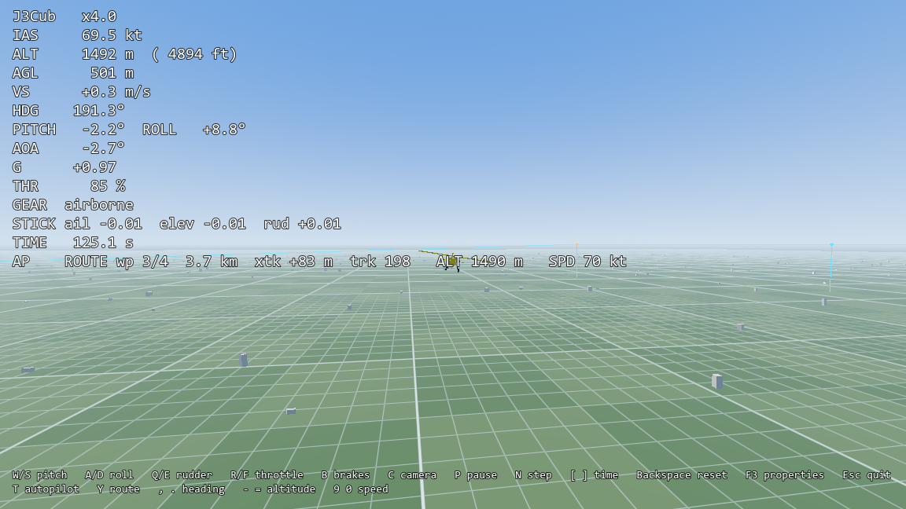

# Autopilot and routes

`JSBSimAutopilot` flies a `JSBSimAircraft` without a pilot: heading, height and airspeed holds, and a list of
waypoints. Add it as a child of the aircraft; it runs before every JSBSim step (120 Hz by default), so it behaves the
same at any frame rate, and it needs no setup in the aircraft's XML.



## Quick start
```gdscript
var autopilot := JSBSimAutopilot.new()
aircraft.add_child(autopilot)       # aircraft: a started JSBSimAircraft
autopilot.engage()                  # on, holding the current heading, height and airspeed
autopilot.target_heading = 120.0    # degrees true
autopilot.target_altitude = 1800.0  # metres above the WGS84 ellipsoid (like JSBSimAircraft.height)
autopilot.target_speed = 65.0       # knots, calibrated
```
A route:
```gdscript
autopilot.add_waypoint(40.95, 29.20)                # latitude, longitude: keeps the height and speed targets
autopilot.add_waypoint(41.00, 29.10, 800.0, 75.0)   # with a height (m, ellipsoid) and an airspeed (kt)
autopilot.add_waypoint_local(Vector3(2000, 600, -3000))  # a scene position (its y is the height)
autopilot.loop_route = true
autopilot.follow_route = true
autopilot.waypoint_reached.connect(func(i): print("reached ", i))
```
In the demo: `T` turns the autopilot on and off, `Y` flies a 4 × 2 km loop, `,` `.` change the heading by 10°,
`-` `=` the height by 50 m, `9` `0` the speed by 5 kt. `--route` and `--autopilot` start that way from the command
line; on the terrain demo `--ground --takeoff --route` takes off and then flies the loop.

## Modes
| property | effect |
|---|---|
| `enabled` | The autopilot flies the stick and pedals. With no mode on: wings level and `target_vertical_speed`. |
| `heading_hold` | Turns to `target_heading` (bank up to `max_bank`). |
| `follow_route` | Flies the route instead: the ground **track** along each leg (so a crosswind is corrected), back to the leg at up to `max_intercept`, the next leg started early by the distance the turn needs. After the last waypoint (without `loop_route`) it keeps the last leg's course in `heading_hold`; `route_finished` is emitted. |
| `altitude_hold` | Climbs or descends to `target_altitude` (at most `max_climb_rate`, `max_descent_rate`). |
| `speed_hold` | Takes the throttle to hold `target_speed`. Without it the throttle stays with the pilot (keyboard, gamepad, your code). |

A waypoint with a height or an airspeed sets `target_altitude` / `target_speed` when it becomes active; they apply
when `altitude_hold` / `speed_hold` are on. Below `min_airspeed` the autopilot gives up height to regain speed
(stall protection), so an underpowered climb is slower but safe.

For HUDs: `get_active_waypoint()`, `get_distance_to_waypoint()`, `get_cross_track_error()` (m, + right of the leg),
`get_desired_track()`, `get_commanded_bank()`, `get_commanded_pitch()`, `get_commanded_vertical_speed()`.

## How it works
Cascaded PID loops on JSBSim's own state (`FGPropagate`, `FGAuxiliary`), written into the aircraft's pilot commands
(`aileron`, `elevator`, `rudder`, `throttle`), which `JSBSimAircraft` passes to JSBSim at every step:

```
heading or route track ─► bank ─► aileron          sideslip ─► rudder (turn coordination)
height ─► vertical speed ─► pitch ─► elevator       airspeed ─► throttle
```
Each loop starts from the current command when it turns on (no jump). The integrators are clamped (anti-windup).

**Why not JSBSim's own autopilot systems?** In JSBSim an autopilot is an aircraft-specific XML `<system>` (the
c172x has one, under the GPL). Using one means editing the aircraft's files and tuning per model; the bundled J3Cub
has none. `JSBSimAutopilot` works the same with every model. If your aircraft has its own JSBSim autopilot, leave
`JSBSimAutopilot` out and drive the model's properties with `get_fdm().set_property(...)` instead.

## Measured with the J3Cub (tests/unit/test_autopilot.gd)
| manoeuvre | result |
|---|---|
| +305 m (1000 ft) climb at 70 kt | within 15 m after 120 s, overshoot 4.5 m (the climb is limited by power: ~2.6 m/s) |
| −305 m descent | within 15 m after 76 s, overshoot 2.6 m |
| 90° / 180° heading change | within 3° after 18 s / 32 s; bank peaks ~28° (`max_bank` 25°); height within 3 m |
| −10 kt speed change | exact after 120 s; height within 4 m |
| 2 km square route | worst cross-track error in the middle of a leg 21 m; 37 m with a 20 kt crosswind |
| 4 × 2 km demo loop, 20 kt crosswind and light turbulence | all waypoints, height within 18 m (`--wind 20 --turbulence 3`) |
| same route at 120, 60, 30, 20, 7.5 FPS | identical position after 90 s (bit for bit) |

`tests/tune_autopilot.gd` prints these numbers (`godot --headless --path . -s res://tests/tune_autopilot.gd`).

## Tuning another aircraft
The defaults suit a light aircraft around 50–100 kt. For another model, in this order:
1. **Roll** (`roll_kp`, `roll_kd`): with only `enabled`, give `max_bank` of commanded bank by setting
   `target_heading` far away with `heading_hold`; the bank should settle without rocking. Too slow: raise `roll_kp`;
   rocking: raise `roll_kd` or lower `roll_kp`.
2. **Pitch** (`pitch_kp`, `pitch_ki`, `pitch_kd`): `target_vertical_speed` steps of ±2 m/s; the pitch should follow
   in 2–4 s without oscillating. Faster aircraft need smaller gains (the elevator is more effective).
3. **Vertical speed** (`vertical_speed_kp`, `vertical_speed_ki`) and **height** (`altitude_gain`): 300 m steps.
4. **Speed** (`speed_kp`, `speed_ki`): ±10 kt steps with `speed_hold`.
5. **Route** (`track_gain`, `track_lookahead`): a larger lookahead returns to the leg more gently; roughly 10 s of
   flight (ground speed × 10).

Set `min_airspeed` a little above the model's stall speed and `max_climb_rate` to what it can climb at full power.
