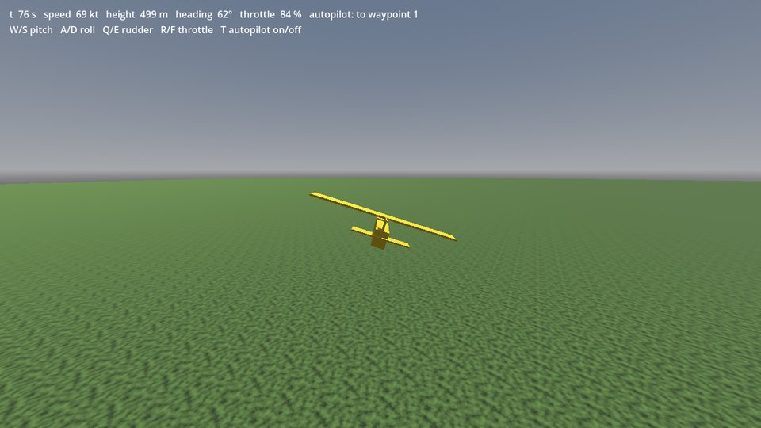
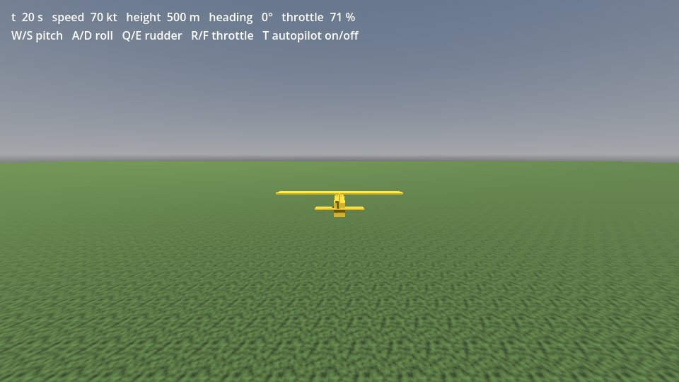

# Getting started

From an empty Godot project to a JSBSim aircraft you fly with the keyboard, then to an autopilot flying a route.
About 15 minutes; no C++ build, only the release zip. Everything is in one GDScript file you can paste.



## What you need
- **Godot 4.3 or newer**, standard (not .NET) build; tested with 4.7.2 ([download](https://godotengine.org/download)).
- **Windows x86_64** (with the [Microsoft Visual C++ Redistributable 2015–2022](https://learn.microsoft.com/cpp/windows/latest-supported-vc-redist),
  usually already installed) or **Linux x86_64**. macOS libraries are in the zip but have not been tried yet.
- The release zip **`godot-jsbsim-<version>.zip`** from the
  [releases page](https://github.com/godot-sac/godot-jsbsim/releases) (or the `godot-jsbsim-*` artifact of a CI run).

## 1. Create a project (2 min)
In the Project Manager: **Create**, name it `my_flight`, renderer **Forward+** (Mobile also works), **Create**.
Close the editor again for the next step (or leave it open and restart it after step 2).

From a terminal instead (the rest of this guide works without the editor too; all commands run in the folder
that contains `my_flight`):
```sh
mkdir my_flight
printf 'config_version=5\n\n[application]\n\nconfig/name="my_flight"\n' > my_flight/project.godot
```

## 2. Add the addon (2 min)
Extract the zip **into the project folder**. It contains one folder, `addons/jsbsim/`, so you get:
```
my_flight/
├── project.godot
└── addons/
    └── jsbsim/
        ├── jsbsim.gdextension
        ├── bin/windows/ bin/linux/ bin/macos/   the extension and the JSBSim library (LGPL-2.1)
        ├── data/aircraft/J3Cub/                  the bundled aircraft (JSBSim data, LGPL-2.1)
        ├── COPYING.JSBSim  COPYING.Expat  COPYING.GeographicLib  JSBSIM_SOURCE.txt  LICENSE
        ├── THIRD_PARTY_NOTICES.md
        └── jsbsim_input.gd  jsbsim_dis_types.gd  icons/
```
```sh
unzip ~/Downloads/godot-jsbsim-<version>.zip -d my_flight      # Linux; on Windows: Extract All… into my_flight
```
Then open the project in the editor once, so Godot registers the extension's classes. Without the editor:
```sh
godot --headless --path my_flight --import
```
(`godot` is your Godot executable, e.g. `Godot_v4.7.2-stable_win64_console.exe` or `Godot_v4.7.2-stable_linux.x86_64`.)

**Check:** in the editor, *Scene → New Scene → Other Node* and type `JSBSim`: `JSBSimAircraft` and
`JSBSimAutopilot` are listed. If they are not, see [Troubleshooting](#troubleshooting).

## 3. Make the scene (3 min)
1. *Scene → New Scene*, choose **3D Scene** as the root, rename the root node to `Main`.
2. Right-click `Main` → *Attach Script…*, path `res://main.gd`, template *Object: Empty*, **Create**.
3. Replace the script's text with the code below and save it (*File → Save* in the script editor).
4. Save the scene: *Scene → Save Scene As…*, `res://main.tscn`.

```gdscript
extends Node3D
## A J3Cub over flat ground at Istanbul Sabiha Gökçen, flown with the keyboard (godot-jsbsim getting started).

const LATITUDE := 40.8932  # start and scene origin, degrees
const LONGITUDE := 29.2948
const GROUND := 126.0      # ground height above the WGS84 ellipsoid, metres

var aircraft: JSBSimAircraft
var camera: Camera3D
var label: Label
var next_report := 0.0


func _ready() -> void:
	_add_world()

	aircraft = JSBSimAircraft.new()
	aircraft.aircraft = "J3Cub"              # from res://addons/jsbsim/data
	aircraft.latitude = LATITUDE
	aircraft.longitude = LONGITUDE
	aircraft.height = GROUND + 500.0         # metres above the ellipsoid: 500 m above the ground
	aircraft.heading = 0.0                   # north, which is -Z in the scene
	aircraft.airspeed = 70.0                 # knots; the aircraft is trimmed for it on start
	aircraft.origin_latitude = LATITUDE      # the scene origin: x east, y up, -z north, in metres
	aircraft.origin_longitude = LONGITUDE
	aircraft.origin_height = GROUND          # so scene y = 0 is the ground
	aircraft.crashed.connect(func(reason: String) -> void: print("crashed: ", reason))
	add_child(aircraft)                      # starts JSBSim
	_add_model(aircraft)

	var input := JSBSimInput.new()           # keyboard and gamepad
	input.aircraft = aircraft
	aircraft.add_child(input)

	camera = Camera3D.new()
	camera.far = 20000.0
	add_child(camera)
	var hud := CanvasLayer.new()
	label = Label.new()
	label.position = Vector2(16, 12)
	hud.add_child(label)
	add_child(hud)


func _process(delta: float) -> void:
	# Chase camera: 15 m behind and 4 m above the aircraft, horizon kept level.
	var forward := -aircraft.global_basis.z
	var back := -Vector3(forward.x, 0.0, forward.z).normalized()
	var target := aircraft.global_position + back * 15.0 + Vector3.UP * 4.0
	camera.global_position = camera.global_position.lerp(target, 1.0 - exp(-4.0 * delta))
	camera.look_at(aircraft.global_position + Vector3.UP, Vector3.UP)

	var fdm := aircraft.get_fdm()
	var status := "t %3.0f s   speed %3.0f kt   height %4.0f m   heading %3d°   throttle %3.0f %%" % [
			fdm.get_sim_time(), fdm.get_property("velocities/vc-kts"), aircraft.position.y,
			roundi(fdm.get_property("attitude/psi-deg")) % 360, aircraft.throttle * 100.0]
	var autopilot := aircraft.get_autopilot()
	if autopilot and autopilot.enabled:
		status += "   autopilot: to waypoint %d" % autopilot.get_active_waypoint()
	label.text = status + "\nW/S pitch   A/D roll   Q/E rudder   R/F throttle   T autopilot on/off"
	if fdm.get_sim_time() >= next_report:  # also visible in a headless run
		next_report += 10.0
		print(status)


## Sky, sun and a 40 km ground plane with a noise texture (something to see moving).
func _add_world() -> void:
	var sky := ProceduralSkyMaterial.new()
	var environment := Environment.new()
	environment.background_mode = Environment.BG_SKY
	environment.sky = Sky.new()
	environment.sky.sky_material = sky
	var world := WorldEnvironment.new()
	world.environment = environment
	add_child(world)

	var sun := DirectionalLight3D.new()
	sun.rotation_degrees = Vector3(-50.0, 30.0, 0.0)
	sun.shadow_enabled = true
	add_child(sun)

	var noise := NoiseTexture2D.new()
	noise.noise = FastNoiseLite.new()
	noise.seamless = true
	var ground_material := StandardMaterial3D.new()
	ground_material.albedo_color = Color(0.45, 0.6, 0.3)
	ground_material.albedo_texture = noise
	ground_material.uv1_scale = Vector3(400.0, 400.0, 1.0)
	var plane := PlaneMesh.new()
	plane.size = Vector2(40000.0, 40000.0)
	plane.material = ground_material
	var ground := MeshInstance3D.new()
	ground.mesh = plane
	add_child(ground)


## A box aircraft looking along -Z (fuselage, wing, tail), about the size of a J-3 Cub.
func _add_model(parent: Node3D) -> void:
	var yellow := StandardMaterial3D.new()
	yellow.albedo_color = Color(0.95, 0.78, 0.15)
	for part: Array in [[Vector3(0.8, 1.0, 6.6), Vector3(0.0, 0.0, 0.2)],
			[Vector3(10.7, 0.14, 1.6), Vector3(0.0, 0.75, -0.9)],
			[Vector3(3.4, 0.08, 0.9), Vector3(0.0, 0.1, 3.3)],
			[Vector3(0.08, 1.1, 1.0), Vector3(0.0, 0.65, 3.3)]]:
		var box := BoxMesh.new()
		box.size = part[0]
		box.material = yellow
		var mesh := MeshInstance3D.new()
		mesh.mesh = box
		mesh.position = part[1]
		parent.add_child(mesh)
```

What it does: `JSBSimAircraft` is a `Node3D` that runs JSBSim (the J3Cub model, trimmed for level flight at 70 kt
when it starts) and moves itself in a local scene frame around a geographic origin: +X east, +Y up, −Z north, in
metres. Heights are above the WGS84 ellipsoid, so with `origin_height` at the ground height, the scene's y is the
height above the ground. `JSBSimInput` turns keyboard and gamepad input into the aircraft's `aileron`,
`elevator`, `rudder` and `throttle`. The rest is a sky, a ground plane, a box model and a chase camera.

Without the editor, save the code as `my_flight/main.gd` (with tabs for indentation, as above) and write the
scene file yourself:
```sh
printf '[gd_scene format=3]\n\n[ext_resource type="Script" path="res://main.gd" id="1"]\n\n[node name="Main" type="Node3D"]\nscript = ExtResource("1")\n' > my_flight/main.tscn
```

## 4. Fly (3 min)
Press **F6** (run current scene), or **F5** and select `main.tscn` as the main scene.



| key | control |
|---|---|
| W / S | stick back / forward (pitch up / down) |
| A / D | roll left / right |
| Q / E | rudder left / right |
| R / F | throttle up / down |

The aircraft starts trimmed: with no key pressed it flies straight and level. Bank with A or D and pull a little
with W to turn. A gamepad works too: left stick for pitch and roll, right stick for the rudder, triggers for the throttle. Fly into the ground and the output says
`crashed: ...`; the aircraft stops (call `aircraft.restart()` to start again).

From a terminal, run 60 seconds of simulation as fast as the computer can (3600 frames of 1/60 s) and read the status lines:
```sh
godot --headless --path my_flight res://main.tscn --fixed-fps 60 --quit-after 3600
```
```
t   0 s   speed  70 kt   height  500 m   heading   0°   throttle  71 %
t  10 s   speed  70 kt   height  500 m   heading   0°   throttle  71 %
...
t  50 s   speed  70 kt   height  500 m   heading   0°   throttle  71 %
```

## 5. Let the autopilot fly a route (3 min)
Add these lines at the end of `_ready()` in `main.gd`:
```gdscript
	# Step 5: an autopilot flies a 3 x 2 km loop 500 m above the ground (scene positions: y is the height).
	var autopilot := JSBSimAutopilot.new()
	aircraft.add_child(autopilot)
	var route := [Vector3(0, 500, -3000), Vector3(2000, 500, -3000), Vector3(2000, 500, 0), Vector3(0, 500, 0)]
	for point: Vector3 in route:
		autopilot.add_waypoint_local(point)
	autopilot.loop_route = true
	autopilot.waypoint_reached.connect(func(index: int) -> void: print("reached waypoint ", index))
	autopilot.engage()             # holds the current heading, height and airspeed
	autopilot.follow_route = true  # and flies the route instead of the heading
```
Run again. The aircraft flies 3 km north, turns right, and keeps flying the 3 × 2 km rectangle; the status line
shows the waypoint it flies to. **T** turns the autopilot off (you fly) and on again (it holds the heading, height
and speed it has, or flies on along the route). `JSBSimAutopilot` runs before every JSBSim step, so the route is
flown the same at any frame rate.

The headless run (now 300 s: 18000 frames) prints the waypoints as they are reached, about every 50–70 s:
```sh
godot --headless --path my_flight res://main.tscn --fixed-fps 60 --quit-after 18000
```
```
t  70 s   speed  70 kt   height  499 m   heading   0°   throttle  71 %   autopilot: to waypoint 0
reached waypoint 0
t  80 s   speed  69 kt   height  500 m   heading  65°   throttle  79 %   autopilot: to waypoint 1
t  90 s   speed  71 kt   height  501 m   heading  84°   throttle  68 %   autopilot: to waypoint 1
...
reached waypoint 1
```
Waypoints can also be geographic: `autopilot.add_waypoint(latitude, longitude, height, speed)`, the height in metres
above the ellipsoid and the speed in knots. Other targets: `target_heading`, `target_altitude`, `target_speed`.

## Next steps
- [autopilot.md](autopilot.md): modes, route options, signals, tuning for another aircraft.
- [input.md](input.md): gamepad and flight stick mapping, your own Input Map actions.
- The README's *Usage* section: ground contact, crash detection, wind and turbulence, DIS with godot-dis, the
  `JSBSimFDM` class for JSBSim without a node.
- [aircraft.md](aircraft.md): other JSBSim aircraft (check their licences first).
- **Exporting your game:** add `*.xml` to *Project → Export → Resources → Filters to export non-resource files*,
  so the aircraft data is in the `.pck`. Keep the JSBSim library a separate file and ship the `COPYING.*` files and
  `JSBSIM_SOURCE.txt` with the game ([licensing.md](licensing.md)).

## Troubleshooting
- **`Parse Error: Identifier "JSBSimAircraft" not declared`** or the classes are not in the *Create Node* dialog:
  the project was not imported after the addon was added. Restart the editor, or run
  `godot --headless --path my_flight --import`. Check that `addons/jsbsim/jsbsim.gdextension` is there (not
  `addons/jsbsim/addons/jsbsim/...` or `godot-jsbsim-<version>/addons/...`).
- **`Can't open dynamic library`**: on Windows install the Visual C++ Redistributable (see *What you need*); the
  `bin/<platform>/` folder must have both the `libgodot_jsbsim...` files and `JSBSim.dll` / `libJSBSim.so.1`.
- **Nothing moves and the output says `JSBSimFDM: ...`**: the model did not load; check the `aircraft` name
  (`J3Cub`, case-sensitive) and that `addons/jsbsim/data/aircraft/J3Cub/J3Cub.xml` exists.
- More in [troubleshooting.md](troubleshooting.md).
