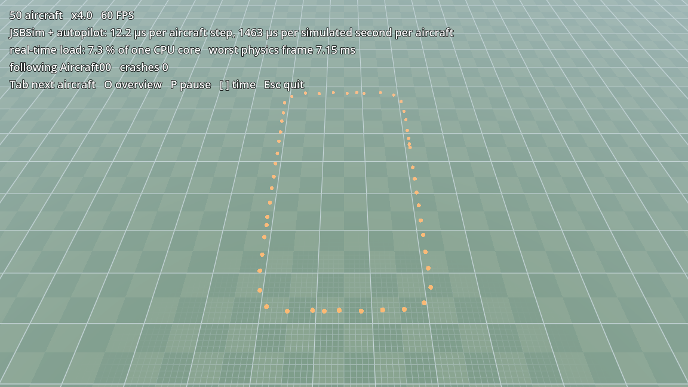

# Performance: many aircraft

How many `JSBSimAircraft` can a game fly at once? Measured with `demo/many_aircraft.tscn`: N J3Cubs evenly spaced
around a 6 × 3 km loop, each with its own `JSBSimAutopilot`, at JSBSim's default 120 Hz.



## Results
CPU time of JSBSim plus our node and autopilot (`JSBSimAircraft.get_last_step_time_usec()`, summed over all aircraft),
per JSBSim step of one aircraft, and as the share of one CPU core needed to run in real time
(= time per simulated second). AMD Ryzen 9 7950X, Godot 4.7.2 headless, the extension's debug build (what the editor
loads), JSBSim 1.3.3 release build; 120 simulated seconds at 4× speed.

| aircraft | ground | autopilot | Windows (MSVC) µs / step | Windows core load | Linux (WSL, GCC) µs / step | Linux core load |
|---:|---|---|---:|---:|---:|---:|
| 1 | flat (built in) | yes | 9.8 | 0.1 % | 13.9 | 0.2 % |
| 10 | flat | yes | 7.5 | 0.9 % | 8.7 | 1.0 % |
| 25 | flat | yes | 7.3 | 2.2 % | 10.5 | 3.2 % |
| 50 | flat | yes | 7.0 | 4.2 % | 10.6 | 6.4 % |
| 100 | flat | yes | 7.5 | 9.0 % | 7.1 | 8.6 % |
| 50 | flat | no (and no models) | 6.9 | 4.1 % | 6.5 | 3.9 % |
| 50 | GDScript node (`height_at`) | yes | 8.7 | 5.2 % | 8.0 | 4.8 % |
| 50 | godot-geo terrain (60 km Ankara) | yes | 19.7 | 11.8 % | — | — |
| 50 | godot-geo terrain (60 km Üsküdar, 2026-11-02) | yes | 19.0 | 11.4 % | — | — |

Linux ran in WSL 2 on the same machine; its numbers scatter more (scheduling inside the VM, one 26 ms frame at 50
aircraft) but agree within a few µs.

Notes:
- One JSBSim step of a light aircraft costs about **7 µs**; the autopilot adds almost nothing (< 0.2 µs). 50
  aircraft in real time need about 4 % of one core, 100 aircraft about 9 %.
- The ground node is called from JSBSim for every gear contact and the centre of gravity (4 queries per J3Cub step,
  more near the ground for the normal). A GDScript `height_at` adds about 2 µs per step; godot-geo's `GeoTerrain`
  (GDScript sampling of the height map) about 13 µs. Terrain is the largest cost: give the ground node a fast
  `height_at` (C++, or a cached height grid) if you fly many aircraft over it.
- The cost per step is the same at any frame rate; at 60 Hz physics every aircraft runs 2 steps per physics frame
  (see [timing.md](timing.md)). With 100 aircraft the worst physics frame was 8.8 ms at 4× speed (8 steps per
  aircraft per frame), so about 2 ms at 1×.
- Drawing is separate: the box models of the demo cost nothing measurable here; real 3D models, shadows and many
  draw calls will dominate long before the simulation does.

## Decision: no worker thread (yet)
The plan was to step the aircraft on a `WorkerThreadPool` only if 50 aircraft needed more than half a core. They
need 4 % (12 % over GDScript terrain), so the simulation stays on the main thread: simpler, deterministic, and the
ground callback can call any node. A thread would also need a thread-safe ground query; godot-geo's GDScript
terrain is not.

If you need hundreds of aircraft or a heavy model: lower `rate` for distant traffic (60 Hz halves the cost; keep
120 Hz for anything on or near the ground), switch off `crash_detection` where it is not needed, and keep the ground
query cheap.

## Measure it yourself
```sh
godot --headless --path . res://demo/many_aircraft.tscn -- --count 50 --seconds 120 --time-scale 4
```
prints a `PERF` line (`usec_per_aircraft_step`, `realtime_load_percent`, `worst_frame_ms`, crashes). Options:
`--gdscript-ground`, `--terrain` (godot-geo linked with `tools/link_siblings.py`), `--no-autopilot`, `--no-models`.
With a window: Tab follows the next aircraft, O switches to the overview camera, `[` `]` change the time scale.
